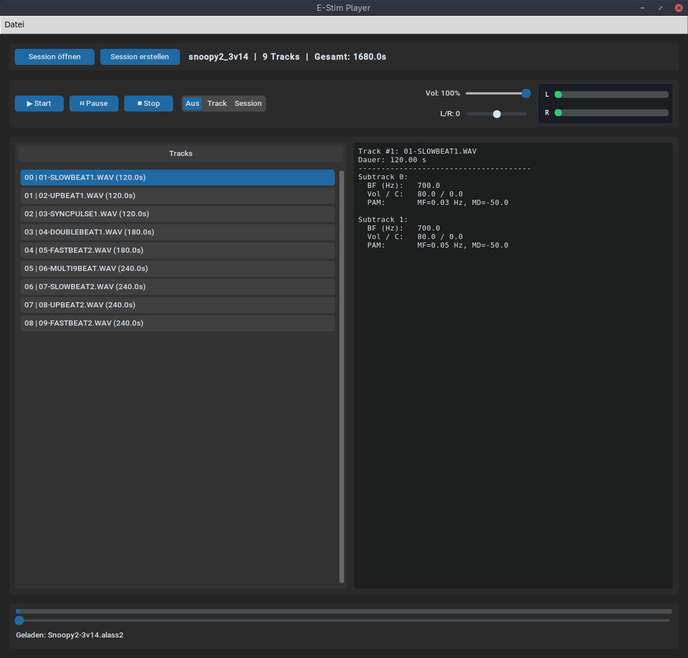
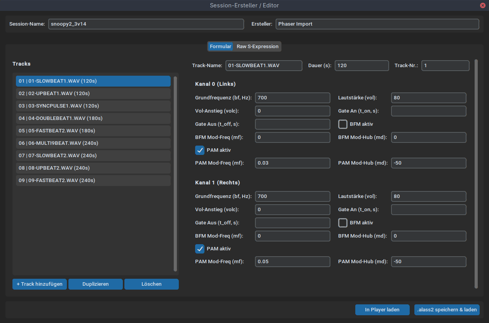

# E-Stim Player

A Python-based player and session editor with a `customtkinter` graphical interface for playing and synthesizing audio and stimulation sessions, as well as exporting to `.flac`.





## Requirements and Installation

### 1. System Dependencies (Linux)

If you are running on Linux, `sounddevice` and `soundfile` typically require system-level PortAudio and libsndfile libraries (example for Debian/Ubuntu):

```bash
sudo apt update && sudo apt install -y libportaudio2 libsndfile1
```

### 2. Install Python Dependencies

Install the required packages from `requirements.txt`:

```bash
pip install -r requirements.txt
```

Included packages:

* `customtkinter` – Modern GUI components
* `numpy` – Signal processing and audio arrays
* `sounddevice` – Real-time audio playback
* `soundfile` – Reading audio files (`.flac`, `.wav`, `.ogg`) and writing `.flac` exports

## Running the Application

Start the script directly with Python:

```bash
python E-Stim-Player.py
```

*(On Linux/macOS, you can also run `./E-Stim-Player.py` if executable permissions are set.)*

## Features Overview

* **Load Sessions & Audio:** Supports session files (such as `.alass2`, `.seq`, `.sexp`, XML/SmartStim), playlists (`.m3u`, `.m3u8`), and standalone audio files (`.flac`, `.wav`, `.ogg`).
* **Session Creator / Editor:** Create and edit tracks and channels via a form or directly in Raw S-Expression mode, complete with syntax validation and `.alass2` saving.
* **Playback & Controls:** Start, pause, stop, loop modes (`Off`, `Track`, `Session`), master volume, stereo balance (`CenterBalanceSlider`), seeking, and a stereo VU meter.
* **FLAC Export:** Export the current track, all tracks as individual `.flac` files, or the entire session as a single `.flac` file.
* **Settings & Localization:** Persists window size, editor size, last directory, volume, balance, loop mode, and UI language (`English` / `Deutsch`) to `~/.config/E-Stim/settings.json`.
